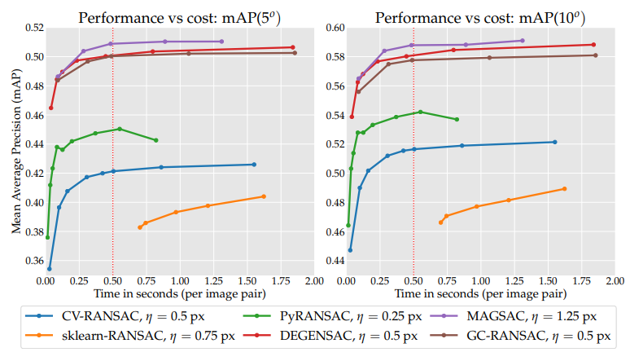
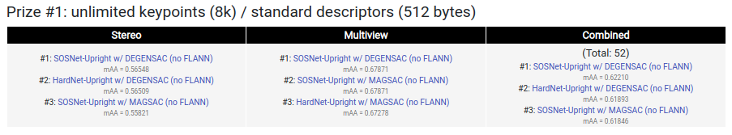
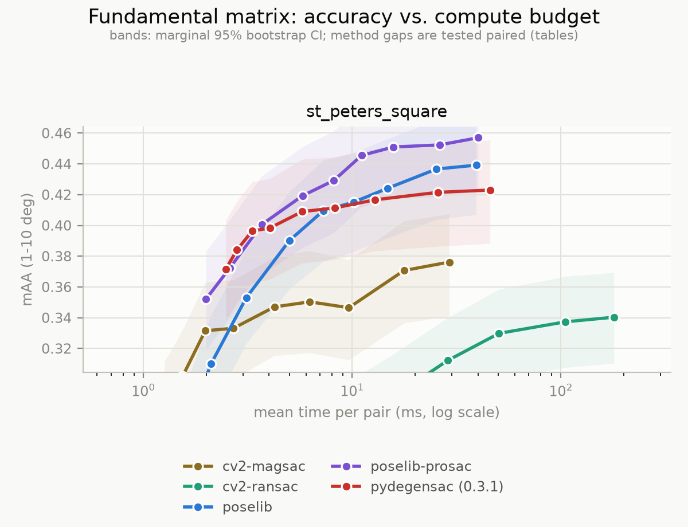
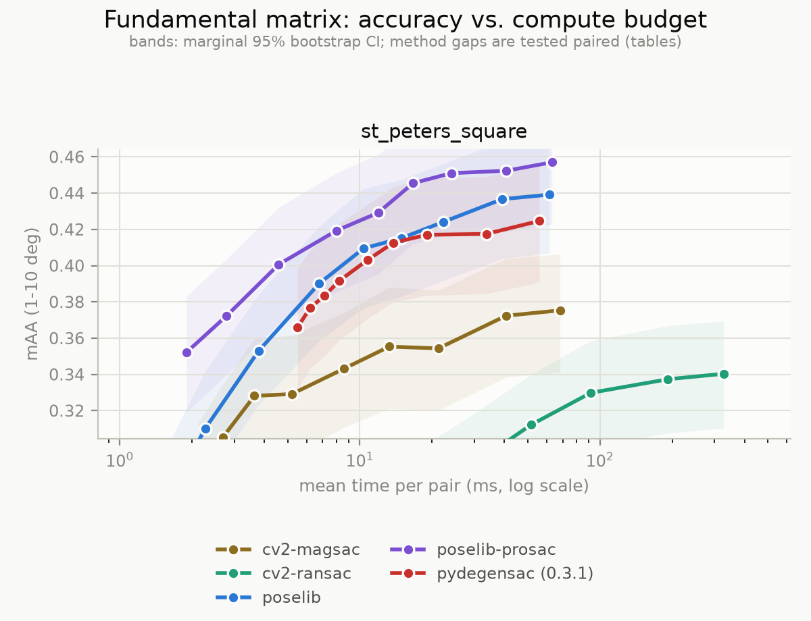
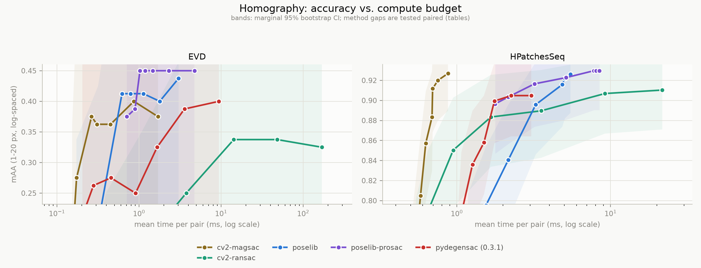
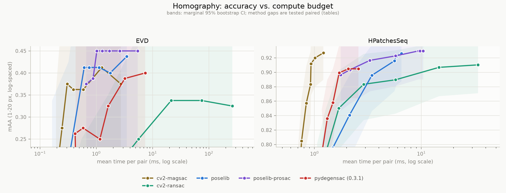

# pydegensac

This repository contains an Python wrapper of RANSAC for homography and fundamental matrix estimation
from sparse correspondences. It implements [LO-RANSAC](https://link.springer.com/chapter/10.1007/978-3-540-45243-0_31) and [DEGENSAC](http://citeseerx.ist.psu.edu/viewdoc/download?doi=10.1.1.466.2719&rep=rep1&type=pdf).

It was originally located in [https://github.com/ducha-aiki/pyransac](https://github.com/ducha-aiki/pyransac), but was renamed to avoid conflict with already existing [pyransac](https://pypi.org/project/pyransac/) in pypi from other author.

> ### macOS users: upgrade
>
> Every macOS build published before **0.3.0** silently skipped all of its
> LAPACK calls. The C sources guarded them behind `#ifdef _WIN32` / `#ifdef
> __linux__`, and macOS defines neither, so the preprocessor removed them: the
> least-squares refits that local optimisation depends on returned an identity
> matrix (F) or an untouched covariance matrix (H). LO-RANSAC's local
> optimisation — the thing that makes this estimator worth using — never ran.
>
> Results were degraded, not broken, so nothing failed loudly: measured on
> public data it cost **0.11 mAA on fundamental and 0.21 on homography**.
> Anything you benchmarked on macOS against other estimators was measuring a
> crippled build. Linux and Windows were unaffected.
>
> To check an existing install:
>
> ```bash
> nm -u $(python -c "import pydegensac,glob,os;print(glob.glob(os.path.dirname(pydegensac.__file__)+'/*.so')[0])") | grep -E 'dgesvd|dsyev'
> ```
>
> Empty output means you have an affected build.

# Performance

Vanilla pydegensac implementation is marginally better than OpenCV one and with degeneracy-check enabled (DEGENSAC) it is the state of the art,
according to the recent study Yin et.al."[Image Matching across Wide Baselines: From Paper to Practice](https://arxiv.org/abs/2003.01587.pdf)", 2020.







For homography, pydegensac is worse than newest OpenCV MAGSAC++ (`cv2.USAC_MAGSAC`), but better than OpenCV vanilla RANSAC, according to recent Barath et al. [A Large Scale Homography Benchmark](https://arxiv.org/abs/2302.09997), CVPR2023


## Speed/accuracy against the current field (2026)

The current comparison runs **pydegensac 0.3.1**, including the latest speed-up,
against **OpenCV 5.0.0** (`RANSAC` and `USAC_MAGSAC`) and **PoseLib 2.0.5**
(with and without PROSAC). Each curve shows one estimator; each point is an
iteration budget. Shaded bands are marginal 95% bootstrap confidence intervals;
method differences are tested with paired intervals in the full reports.

The public datasets and metrics are unchanged: fundamental matrix on 600
IMC-2020 PhotoTourism validation pairs from `st_peters_square` (pose mAA 1–10°),
and homography on EVD (8 test pairs) and HPatchesSeq (145 test pairs), using
reprojection mAA 1–20 px. Thresholds are retained from the previous tuning,
which used OpenCV 4.13; they have not been retuned for OpenCV 5.0.

<table>
<tr><th width="50%">Linux x86-64</th><th width="50%">Apple M1</th></tr>
<tr>
<td></td>
<td></td>
</tr>
<tr>
<td></td>
<td></td>
</tr>
</table>

These are single-threaded estimator calls (Linux: Intel Core i7-14700K WSL2; Apple M1: MacBook Air). pydegensac uses **seed 12345**, reset for every pair and iteration budget; OpenCV and PoseLib retain their estimator defaults. These are single-seed measurements: confidence intervals resample image pairs, not seeds, repeated runs, or timing noise.

**Fundamental matrix.** At each method's best budget:
- On **Linux**, pydegensac reaches 0.423 mAA at 51.2 ms/pair, compared with PoseLib PROSAC's 0.457 at 40.3 ms (paired gap -0.034 mAA, 95% CI -0.055 to -0.012). OpenCV MAGSAC reaches 0.376 at 29.9 ms; OpenCV RANSAC reaches 0.340 at 183.7 ms.
- On **Apple M1**, pydegensac reaches 0.425 mAA at 56.0 ms/pair, compared with PoseLib PROSAC's 0.457 at 63.1 ms (paired gap -0.033 mAA, 95% CI -0.055 to -0.010). OpenCV MAGSAC reaches 0.375 at 68.3 ms; OpenCV RANSAC reaches 0.340 at 327.7 ms.

**Homography.** On HPatchesSeq, at each method's best budget:
- On **Linux**, pydegensac reaches 0.9048 mAA at 2.25 ms/pair (6,400 iterations). OpenCV MAGSAC reaches 0.9269 at 0.88 ms, while PoseLib PROSAC reaches 0.9297 at 7.79 ms (paired pydegensac gap -0.025 mAA, 95% CI -0.042 to -0.012).
- On **Apple M1**, pydegensac reaches 0.9048 mAA at 2.08 ms/pair (6,400 iterations). OpenCV MAGSAC reaches 0.9269 at 1.21 ms, while PoseLib PROSAC reaches 0.9297 at 9.41 ms (paired pydegensac gap -0.025 mAA, 95% CI -0.042 to -0.012).

On both platforms, EVD has only 8 test pairs and much wider intervals; it does not separate pydegensac from the leader in either run.

Full results:
- Linux: [fundamental matrix](benchmarks/results/report_f_linux.md) and [homography](benchmarks/results/report_h_linux.md)
- Apple M1: [fundamental matrix](benchmarks/results/report_f_m1.md) and [homography](benchmarks/results/report_h_m1.md)

See [benchmark instructions](benchmarks/README.md) for dependencies and the
protocol, and the [earlier study](docs/reports/2026-08-11-ransac-benchmark.md)
for historical results and threshold-transfer caveats.
Reproduce with `cd benchmarks && python setup_data.py && ./run_current.sh linux`
(or `./run_current.sh m1` on the M1 machine).

# Installation

To build and install `pydegensac`, you can use pip from Windows, macOS and Linux:

```bash
pip install pydegensac
```

> **Do not pin `pydegensac==0.1.2` if you are on numpy 2.x.** That combination
> returns **every correspondence as an inlier**, silently — on a synthetic set
> with 150 planted outliers among 300 matches it reports 300 inliers, where the
> same wheel under numpy 1.26 correctly reports 150. It is the old pybind11
> incompatibility that `0.2` was yanked for, but `0.1.2` was never yanked, so
> it is what an old pin or an unconstrained resolve on a fresh numpy can still
> land on. Use the latest release, or hold numpy below 2.0.

Or clone or download this repository and then, from within the repository, run:

```bash
python3 ./setup.py install
```

or

```bash
pip3 install .
```

To check if everything works, run the following:

```bash
cd examples
python -utt simple-example.py
```

You should see the following output:

```
Num tentatives: 625
Running homography estimation
cv2 found 39 inliers
OpenCV runtime 0.01810  sec
pydegensac found 74 inliers
pydegensac runtime 0.00251  sec
H =  [[ 3.11780982e-01  5.25464685e-02 -1.03843008e+03]
 [ 1.74306833e+00 -4.19829687e+00 -3.96516667e+02]
 [ 6.90073255e-03  2.20936659e-04 -6.11602534e+00]]
Running fundamental matrix estimation
cv2 found 32 inliers
OpenCV runtime 0.51542  sec
pydegensac found 77 inliers
pydegensac 0.05508  sec
F =  [[ 6.48569395e-06  5.83116242e-05 -2.14328944e-02]
 [-2.87155326e-05 -1.89643410e-07  1.49425716e-02]
 [ 6.96294565e-03 -2.02712455e-02  2.67319526e+00]]
```

# Building hints from Tomasz Malisiewicz

1. Compiling pydegensac without a system-wide install.

```bash
python3 ./setup.py build
```

2. Compiling on Mac OS X computer
Use GCC instead of Clang. The most recent version on my machine (installed via brew) is gcc-8. Try this:

```bash
CC=gcc-8 python3 ./setup.py build
```

*(Note, 2026: this hint dates from 2020. Current Clang builds pydegensac fine and is the recommended compiler on macOS — prefer the platform default unless you hit an actual failure.)*

3. Compiling on Ubuntu 18.04
You need LAPACK and a few other libraries and I always forget those specific package names. Take a look at my pydegensac Dockerfile to see the exact packages you need to apt install on an Ubuntu 18.04 system (https://github.com/quantombone/pydegensac-dockerfile/blob/master/Dockerfile)

```bash
FROM ubuntu:18.04
```

## update system
```bash
RUN apt-get clean
RUN apt-get update
RUN apt-get install -qy \
    git python3 python3-setuptools python3-dev
RUN apt-get install -y cmake libblas-dev liblapack-dev gfortran
RUN apt-get install -y g++ gcc
```

## download and build pydegensac
```
RUN git clone https://github.com/ducha-aiki/pydegensac.git
WORKDIR pydegensac
RUN python3 ./setup.py build
```

## copy built assets into target directory (which will be a -v volume)
```docker
CMD cp -R /pydegensac/build/lib.linux-x86_64-3.6/pydegensac /target_directory
```

# dockerfile

https://github.com/quantombone/pydegensac-dockerfile


# Example of usage

```python
import pydegensac
H, mask = pydegensac.findHomography(src_pts, dst_pts, 3.0)
F, mask = pydegensac.findFundamentalMatrix(src_pts, dst_pts, 3.0)

```

See also this [notebook](examples/simple-example.ipynb) with simple example

And this [notebook](examples/how-to-use-detailed.ipynb) with detailed explanation of possible options


# Requirements

- Python 3
- CMake 2.8.12 or higher
- LAPACK, 
- BLAS (OpenBLAS, MKL, Atlas, ...)
- A modern compiler with C++11 support


## Citation

Please cite us if you use this code:

    @InProceedings{Chum2003,
    author="Chum, Ond{\v{r}}ej and Matas, Ji{\v{r}}{\'i} and Kittler, Josef",
    title="Locally Optimized RANSAC",
    booktitle="Pattern Recognition",
    year="2003",
    }
    
    @inproceedings{Chum2005,
    author = {Chum, Ondrej and Werner, Tomas and Matas, Jiri},
    title = {Two-View Geometry Estimation Unaffected by a Dominant Plane},
    booktitle = {CVPR},
    year = {2005},
    }
    
    @article{Mishkin2015MODS,
          title = "MODS: Fast and robust method for two-view matching ",
          journal = "Computer Vision and Image Understanding ",
          year = "2015",
          issn = "1077-3142",
          doi = "http://dx.doi.org/10.1016/j.cviu.2015.08.005",
          url = "http://www.sciencedirect.com/science/article/pii/S1077314215001800",
          author = "Dmytro Mishkin and Jiri Matas and Michal Perdoch"
    }
    


    
# Acknowledgements

This wrapper part is based on great [Benjamin Jack `python_cpp_example`](https://github.com/benjaminjack/python_cpp_example).
